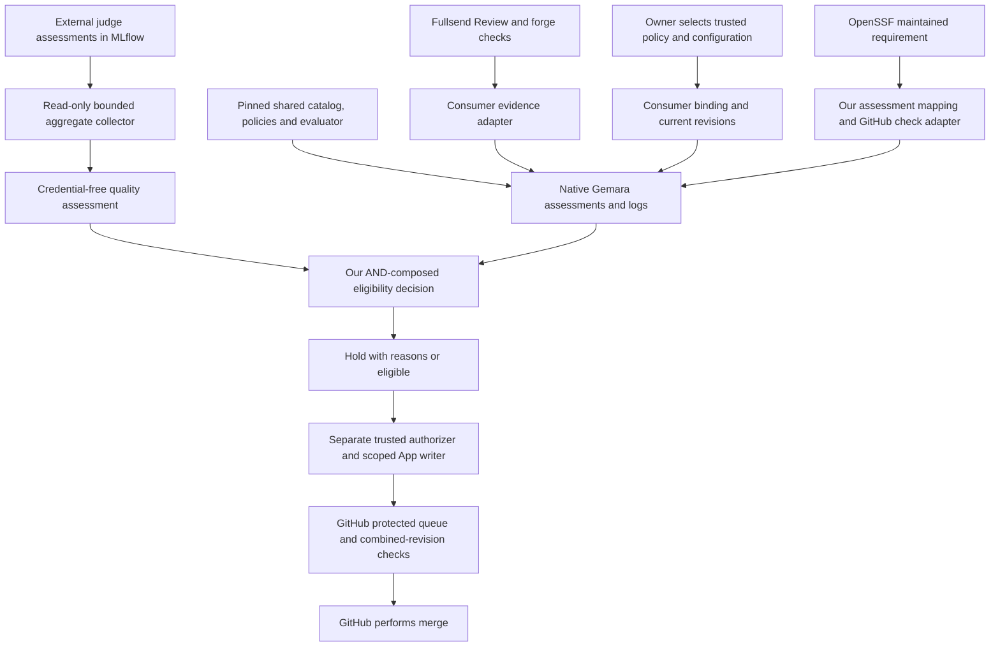

# 29. Gemara-assessed auto-merge for Fullsend PRs

Date: 2026-10-24

This is a retrospective record of a lab that used [Gemara](https://github.com/gemaraproj/gemara) to assess Fullsend PRs before an existing protected GitHub merge path. It also provides an offline reproduction with invented fixtures. It records a lab result. Fullsend did not adopt it, and the broader choice of policy engine remains open.

Companion research issue: [fullsend#8789](https://github.com/fullsend-ai/fullsend/issues/8789). This directory holds the public reproduction and results record. The companion issue connects these findings to Fullsend's research questions.

**Gemara does not create the MLflow judge, authenticate GitHub evidence, mint App tokens, grant owner authority or merge PRs.** Gemara supplies schemas and SDK machinery that run assessments and record native evaluation logs. Everything else in the diagram below was built by us or provided by GitHub.

## Hypothesis

1. One shared policy and evaluator can express owner requirements for several consumers, while forge identity, trusted evidence and mutation stay local to each consumer.
2. A separate quality condition can hold an otherwise passing PR. Its threshold can change without changing the measurement.
3. Selecting a maintained OpenSSF requirement can add useful behavior to an existing policy. The question is how much custom implementation it still needs.
4. Assessment output can feed an existing protected GitHub merge path without blurring policy *eligibility* into owner-authorized *mutation*.
5. How does the resulting owner experience and maintenance cost compare with the hoped-for "just select a policy"? And what did this experiment *not* establish about Gemara's suitability?

## Approach



The diagram maps dependencies and authority. It does not show Gemara scheduling collectors or running a judge.

| Layer | Owns |
| --- | --- |
| Gemara upstream | Schemas and model; Go SDK assessment and evaluation machinery |
| OpenSSF upstream | OSPS requirement content and applicability. This is maintained content, not a ready-made GitHub scanner |
| Our shared public module ([fullsend-gemara-integration@61a0146](https://github.com/ascerra/fullsend-gemara-integration/tree/61a01465478e50d8e9b3e21dd056fdef90baff30)) | Common catalog and policies, deterministic evaluators, judge-aggregate check, CLI, normalized types, synthetic examples, collector |
| Consumer repository ([auto-merge@4c86073](https://github.com/fullsend-ai/auto-merge/tree/4c86073ea6e05aff69b22b261eb7e2c74f3a5f71)) | Trusted source pins, forge identity, current PR/base/merge-group subject, evidence publishers and collectors, owner scope, quality threshold/window/freshness, selected optional controls, credential boundary |
| Existing writer and forge | Revalidation, short-lived repository-scoped write identity, protected enrollment, combined-revision CI and assessment, the actual merge |

Reusing a policy does not mean sharing write credentials. It does not mean trusting a PR's own policy changes to authorize that PR. It does not make a JSON digest an authenticated source.

The lab ran six scenarios (A–F below). This directory republishes only public metadata and adds synthetic fixtures for offline replay.

## Results

Hosted observations are summarized here and detailed in [RESULTS.md](RESULTS.md). Every link is listed in [evidence/sources.json](evidence/sources.json).

| Scenario | Historical hosted observation | Offline replay (this directory) |
| --- | --- | --- |
| A. Review evidence baseline | Preparatory [PR #50](https://github.com/fullsend-ai/auto-merge/pull/50) and [PR #52](https://github.com/fullsend-ai/auto-merge/pull/52) made Review output consumable: completed approval, findings, risk, exact revision and configuration | Encoded in the candidate fixture |
| B. Shared policy, missing risk | The five shared controls are reusable across GitHub and GitLab bindings. A private GitLab consumer was expected to hold because its Review output lacked a risk assessment | S04: synthetic GitLab consumer with approval and green CI but no risk → **hold** |
| C. Quality at 99% | 238 / 254 = 93.7008…% < 99% → quality Failed → composed hold; the writer skipped enrollment ([PR #53](https://github.com/fullsend-ai/auto-merge/pull/53), still open) | S01 → **hold** |
| D. Owner lowers threshold to 90% | Same counts pass quality. [PR #56](https://github.com/fullsend-ai/auto-merge/pull/56) was the earlier merged 90% case; [PR #54](https://github.com/fullsend-ai/auto-merge/pull/54) was not merged | S02 → **eligible**, with no authorization and no writer call |
| E. Add OSPS-QA-03.01 | The selected requirement passed at enrollment and at queue validation for PR #58 | S05: optional check failed while required checks were green → **hold**; all relevant checks green → pass |
| F. Protected merge and cleanup | Issue #57 → [PR #58](https://github.com/fullsend-ai/auto-merge/pull/58). App enqueued it at 12:58:50 UTC; GitHub merged `fee00797` at 13:03:51 UTC on 2026-10-23; cleanup commit `4c86073e` returned the lab to shadow mode | S09: candidate evidence relabelled inconsistently for the merge-group head → **hold**; relabelled consistently it is **not detected** by the CLI, so fresh merge-group collection is required; S08: mock writer never called in shadow mode or without active authority |

The hold cases (S01, S04, S05 and S06–S08) are successful demonstrations of policy behavior, not failures.

## Run it offline

Requirements: Go 1.25 or newer (the shared module's CI uses 1.26) and Python 3.11 or newer. From the repository root:

```sh
0029-gemara-auto-merge/scripts/reproduce.sh
```

On the first run, `go install` downloads the pinned shared CLI (`github.com/ascerra/fullsend-gemara-integration/cmd/gemara-owner@61a01465…`) and its pinned SDK into `.cache/` (git-ignored). That is the only network step. After setup, scenarios run offline at the fixed time `2026-10-20T00:10:00Z`. They use no secrets, no GitHub write access, no MLflow and no LLM. Set `GEMARA_OWNER=/path/to/gemara-owner` to reuse an existing build; `reproduce.sh` fails if it does not embed the pinned revision (`go version -m`), and reinstalls a cached build at another revision. Add `--json` to get full observations.

```text
PASS  S01 clean candidate + 238/254 at 99% -> hold
PASS  S02 same inputs at 90% -> eligible, no mutation
PASS  S03 integer threshold boundary
PASS  S04 GitLab consumer missing risk -> hold
PASS  S05 OSPS-QA-03.01 observed checks
PASS  S06 missing/stale/insufficient/malformed judge evidence -> not passed
PASS  S07 head mismatch or untrusted evidence -> hold
PASS  S08 shadow/absent/expired authority -> no writer call (mock)
PASS  S09 merge-group relabel: inconsistent -> hold, consistent -> not detected
PASS  S10 two runs at fixed time 2026-10-20T00:10:00Z produce identical summaries
```

This is a **new local result** (2026-10-24), separate from the historical hosted observations. The mocked writer assertions are not a second live protected-merge test.

| Path | Purpose |
| --- | --- |
| [scripts/reproduce.sh](scripts/reproduce.sh) | Setup (pinned `go install`), then run the scenarios and unit tests |
| [scripts/scenarios.py](scripts/scenarios.py) | Feeds fixtures to the shared `gemara-owner` CLI (`assess-candidate`, `check-judge`, `evaluate-fixture`) and compares results with expectations |
| [tests/test_scenarios.py](tests/test_scenarios.py) | 19 standard-library tests. CLI-backed tests skip if the binary is missing |
| [fixtures/](fixtures/) | Invented inputs. Each file has `"synthetic": true`; the CLI input sits under `cli_input` |
| [evidence/sources.json](evidence/sources.json) | Public source register: claim IDs, revisions, artifacts, observation date, status |

Policy semantics (the five controls, quality threshold, freshness, subject binding) come from the shared CLI. They are not reimplemented here. Two small parts are **local replay models**, because the lab repository publishes no license and its code is not copied:

- The OSPS-QA-03.01 check-run/status semantics of the lab's [GitHub adapter](https://github.com/fullsend-ai/auto-merge/blob/4c86073ea6e05aff69b22b261eb7e2c74f3a5f71/gemara-auto-merge/configured_policy.py#L51-L123).
- A writer gate that keeps eligibility separate from owner authority. It drives a recording mock and never a real writer.

The replay labels its results Passed, Failed or Unknown. These labels are this experiment's. The lab recorded its results through its native SDK step.

The native Gemara logs inside CLI reports include SDK wall-clock `start`/`end` stamps. The determinism check (S10) compares decisions, states, reasons, counts and digests, not those stamps.

## Owner configuration

The lab's experimental owner surface in [`.fullsend/config.yaml`](https://github.com/fullsend-ai/auto-merge/blob/4c86073ea6e05aff69b22b261eb7e2c74f3a5f71/.fullsend/config.yaml):

```yaml
auto_merge:
  mode: shadow
  policy: fullsend-default
  controls:
    - OSPS-QA-03.01
```

A locally modified Fullsend build, carried as a vendored binary plus a source patch, supported this block. **It is not a released Fullsend feature.** See [docs/OWNER-WALKTHROUGH.md](docs/OWNER-WALKTHROUGH.md) for where it lives, who maintains it, and the PR → review → assessment → queue → merge flow. See [docs/OWNERSHIP-AND-MAINTENANCE.md](docs/OWNERSHIP-AND-MAINTENANCE.md) for responsibilities, pins, update procedure and the measured code footprint.

## Conclusion

- **H1 — partly supported.** One pinned catalog, policy and evaluator served GitHub and GitLab bindings with identical policy digests. Forge identity, evidence adapters and credentials stayed per consumer. Public evidence for GitLab is synthetic only. No live GitLab merge happened, and enforcement infrastructure was not identical across forges.
- **H2 — supported in the lab.** A 99% threshold held an otherwise eligible PR. Changing only the owner threshold to 90% made the same observation pass. The threshold is an owner choice and not statistically validated. The 93.70% figure is a pass rate among scored approvals. It is not review accuracy, and it is not a probability that the next PR is safe.
- **H3 — supported, at a cost.** OSPS-QA-03.01 caught a failed optional check that required-check enforcement ignored. It still needed our own trusted adapter, a mapping, a source pin and tests: 454 dedicated lines. Adding an arbitrary upstream control is not plug-and-play.
- **H4 — demonstrated once.** One PR moved from assessment through a separate App writer to GitHub's protected queue and merge. The queue re-assessed the combined revision. Eligibility never carried authority: shadow mode and an expired grant blocked writes.
- **H5 — the owner experience fell short of "select a policy".** Owners gained a common vocabulary, explicit missing and failed results, upstream provenance and traceable evidence-to-decision reports. They also took on custom adapters, schema and version management, source authentication, protected execution, queue reconciliation and a steep comprehension cost.

**Not established:** threshold validity, scorer correctness, agreement with independent human reviewers, coverage of the scored population, cohort isolation by agent or rubric version, long-term availability, production rollout safety, superiority over simpler native policy structures, and live GitLab merging.

Related problem docs (this experiment supplies an observation; it does not resolve them): [trustworthiness evidence](https://github.com/fullsend-ai/fullsend/blob/6d925afefb5bbe97853ad7b35f88916e9d3e8111/docs/problems/trustworthiness-evidence.md#composing-evidence-into-trust-decisions), [governance: configuration security](https://github.com/fullsend-ai/fullsend/blob/6d925afefb5bbe97853ad7b35f88916e9d3e8111/docs/problems/governance.md#2-configuration-security), [autonomy spectrum: graduation criteria](https://github.com/fullsend-ai/fullsend/blob/6d925afefb5bbe97853ad7b35f88916e9d3e8111/docs/problems/autonomy-spectrum.md#graduation-criteria), [graduated approval policy](https://github.com/fullsend-ai/fullsend/blob/6d925afefb5bbe97853ad7b35f88916e9d3e8111/docs/problems/graduated-approval-policy.md#path-forward), [code review: composing decisions](https://github.com/fullsend-ai/fullsend/blob/6d925afefb5bbe97853ad7b35f88916e9d3e8111/docs/problems/code-review.md#how-sub-agents-compose-a-decision), [review autonomy evidence](https://github.com/fullsend-ai/fullsend/blob/6d925afefb5bbe97853ad7b35f88916e9d3e8111/docs/problems/review-autonomy-evidence.md#open-questions).

Status is **Concluded**: publication and offline reproduction are complete, and no further runs are planned. It is not **Merged**, because nothing was adopted into Fullsend.

## Notices

The shared module and Gemara SDK are Apache-2.0 and are downloaded at pinned revisions, not vendored. This directory copies no upstream code or requirement text. The OSPS-QA-03.01 requirement is referenced by ID and link only. The lab repository `fullsend-ai/auto-merge` publishes no license file, so its files are linked and never copied. Fixtures are newly authored. Their JSON shapes follow the shared module's public input contracts.
