# Owner walkthrough

This page follows a repository owner from choosing a policy to a merged PR. Each step says what the file or action is, why it exists, who maintains it, and where the public evidence is. All links are listed in [../evidence/sources.json](../evidence/sources.json).

```mermaid
flowchart LR
    C[1. Select policy in .fullsend/config.yaml] --> I[2. Issue #57]
    I --> P[3. PR #58]
    P --> R[4. Fullsend Review on current head]
    R --> A[5. Assessment: 5 controls + quality + OSPS-QA-03.01]
    A --> W[6. Separate App writer enrolls in queue]
    W --> Q[7. Queue re-assesses combined revision]
    Q --> M[8. GitHub merges]
    M --> X[9. Cleanup: back to shadow]
```



## 1. Select the policy

**File:** [`.fullsend/config.yaml`](https://github.com/fullsend-ai/auto-merge/blob/4c86073ea6e05aff69b22b261eb7e2c74f3a5f71/.fullsend/config.yaml) in the consumer repository.

```yaml
auto_merge:
  mode: shadow
  policy: fullsend-default
  controls:
    - OSPS-QA-03.01
```

- **Why it exists.** It is the owner's single statement of intent. `mode` is `off`, `shadow` or `enforce`. `policy` names the shared policy. `controls` adds optional maintained requirements.
- **Who maintains it.** The repository owner. A managed installation sets the same block under the repository's `config:` in `repos.yaml`, or under `defaults.config` to inherit it. Management then writes `.fullsend/config.yaml`; do not edit a managed file by hand.
- **Inheritance.** `off` overrides an inherited enablement. `controls: []` clears inherited optional selections.
- **Status.** This schema is **local experimental work**. A modified Fullsend build, carried as a [vendored binary with recorded provenance](https://github.com/fullsend-ai/auto-merge/blob/4c86073ea6e05aff69b22b261eb7e2c74f3a5f71/.fullsend/local-build.json) and a [source patch](https://github.com/fullsend-ai/auto-merge/blob/4c86073ea6e05aff69b22b261eb7e2c74f3a5f71/gemara-auto-merge/local-fullsend.patch), materialized these settings. It also supported `fullsend auto-merge config` to inspect the effective configuration. It is not a released Fullsend feature. `repos.yaml` handling was tested only locally.
- **Limits.** `enforce` alone cannot mint authority or renew an expired grant. Adding an arbitrary upstream control is not plug-and-play: each one needs a trusted implementation and evidence adapter. The lab's [owner flow for adding a control](https://github.com/fullsend-ai/auto-merge/blob/4c86073ea6e05aff69b22b261eb7e2c74f3a5f71/docs/ADD-AN-UPSTREAM-CONTROL.md) describes what this one required.

The quality threshold, window and freshness live in separate trusted consumer configuration and are loaded from the protected base, never from the candidate branch. See [quality-policy-9900.json](../fixtures/quality-policy-9900.json) and [quality-policy-9000.json](../fixtures/quality-policy-9000.json) for the synthetic shapes.

## 2. Issue

[Issue #57](https://github.com/fullsend-ai/auto-merge/issues/57) describes the documentation change. Keep the demonstration issue separate from setup and owner-scope changes, because mixing them caused review friction in earlier attempts.

## 3. PR

[PR #58](https://github.com/fullsend-ai/auto-merge/pull/58) implements the change, touching only owner-allowed documentation paths. **OWNER-SCOPE** checks those paths against the binding: governed paths such as `.github/**`, `.fullsend/**` or `policy/**` hold, even for a one-line change.

## 4. Review on the current head

[Fullsend Review run 39955761534](https://github.com/fullsend-ai/auto-merge/actions/runs/39955761534) reviewed head `14499514…` with trusted configuration `5f4f8f39…`. It reported an approval, no unresolved findings and low risk. The [review-evidence contract](https://github.com/fullsend-ai/auto-merge/blob/4c86073ea6e05aff69b22b261eb7e2c74f3a5f71/gemara-auto-merge/review_evidence_contract.py) and [GitHub evidence collector](https://github.com/fullsend-ai/auto-merge/blob/4c86073ea6e05aff69b22b261eb7e2c74f3a5f71/gemara-auto-merge/github_pr_evidence.py) turn this output into the normalized observation. Without a risk assessment, **REVIEW-CLEAR** is Unknown and the PR holds (replay S04).

## 5. Assessment

The [automatic evaluation workflow](https://github.com/fullsend-ai/auto-merge/blob/4c86073ea6e05aff69b22b261eb7e2c74f3a5f71/.github/workflows/gemara-auto-merge.yml) ([run 39956959534](https://github.com/fullsend-ai/auto-merge/actions/runs/39956959534)) runs the pinned shared evaluator through the [shared gate adapter](https://github.com/fullsend-ai/auto-merge/blob/4c86073ea6e05aff69b22b261eb7e2c74f3a5f71/gemara-auto-merge/shared_gate.py), inside a [separate execution boundary](https://github.com/fullsend-ai/auto-merge/blob/4c86073ea6e05aff69b22b261eb7e2c74f3a5f71/scripts/shared_gate_runtime.py) with no write credential. It then adds the quality check and the selected OpenSSF requirement. The result is AND-composed: one Failed or Unknown means hold.

Open the artifact and read its decision. A green workflow job only means the observation completed; the decision inside can still be **hold**.

Try it offline: `scripts/reproduce.sh` (see the [README](../README.md#run-it-offline)). S01 shows a 99% hold, S02 shows 90% eligibility, and S05 shows the OpenSSF requirement.

## 6. Writer and queue enrollment

The [trusted authorizer](https://github.com/fullsend-ai/auto-merge/blob/4c86073ea6e05aff69b22b261eb7e2c74f3a5f71/gemara-auto-merge/authorize_auto_merge.py) and [existing App writer](https://github.com/fullsend-ai/auto-merge/blob/4c86073ea6e05aff69b22b261eb7e2c74f3a5f71/.github/workflows/gemara-queue-writer.yml) are separate from assessment. They revalidate, obtain a short-lived repository-scoped token and request protected-queue enrollment: [job 120426280311](https://github.com/fullsend-ai/auto-merge/actions/runs/39956959534/job/120426280311). The timeline shows the App adding PR #58 to the queue at 12:58:50 UTC. Eligibility is necessary but never sufficient. Shadow mode, a missing grant or an expired grant prevents any write (replay S08, mock only).

## 7. Queue validation on the combined revision

[Merge-queue validation](https://github.com/fullsend-ai/auto-merge/blob/4c86073ea6e05aff69b22b261eb7e2c74f3a5f71/.github/workflows/gemara-merge-queue.yml) ([run 39957499141](https://github.com/fullsend-ai/auto-merge/actions/runs/39957499141)) and [CI 39957499387](https://github.com/fullsend-ai/auto-merge/actions/runs/39957499387) assess `fee00797…`, the revision that would land. That is not the reviewed head `14499514…` (replay S09).

## 8. Merge

GitHub's merge queue merged PR #58 at 13:03:51 UTC on 2026-10-23 as [`fee00797`](https://github.com/fullsend-ai/auto-merge/commit/fee00797c19a07a2e3bdd83ce7fd1dbc917087f1). Gemara assessed. GitHub merged.

## 9. Cleanup

[Commit `4c86073e`](https://github.com/fullsend-ai/auto-merge/commit/4c86073ea6e05aff69b22b261eb7e2c74f3a5f71) set the mode back to shadow and disabled grants, and [CI 39958588002](https://github.com/fullsend-ai/auto-merge/actions/runs/39958588002) passed. The [read-only shadow observation workflow](https://github.com/fullsend-ai/auto-merge/blob/4c86073ea6e05aff69b22b261eb7e2c74f3a5f71/.github/workflows/gemara-shadow-observation.yml) can still evaluate PRs without needing or using merge authority.
