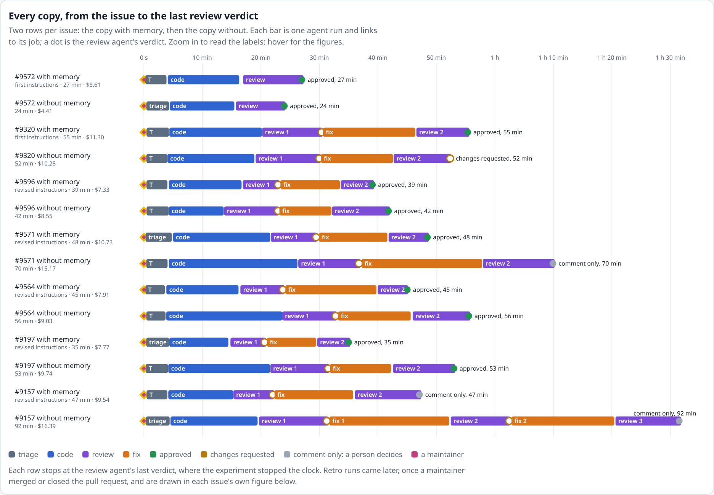

# 32. Shared long-term memory for fullsend agents

Date: 2026-11-24

We gave fullsend's stock agents a shared long-term memory in one test repository, and ran the same seven bug reports in a second repository that was the same except for memory. With memory instructions revised after the first two issues, every one of the next five issues cost less and reached its last review verdict sooner with memory: in total 26% less cost and 31% less time. Most of the saving came from agents reusing a few workarounds that earlier runs had recorded. Two of those workarounds are changes fullsend can make without memory, and one of them has already landed. The comparison is small: one run per side per issue.

## Hypothesis

If the agents working in one repository share a memory of what earlier runs learned, they repeat fewer known problems. Each issue then costs less and reaches its last review verdict sooner than the same issue in an otherwise identical repository without memory.

## Approach

**Two test repositories, alike except for memory.** Both started from the same snapshot of fullsend ([`8396e682`](https://github.com/fullsend-ai/fullsend/tree/8396e6827eca), plus one fix the agents made to `repos uninstall` before the first issue) and run fullsend's stock agents from fullsend-ai/agents v0.57.1:

- [ascerra/fullsend-memory-poc](https://github.com/ascerra/fullsend-memory-poc), with memory;
- [ascerra/fullsend-memory-poc-baseline](https://github.com/ascerra/fullsend-memory-poc-baseline), without.

Each side merged its own fixes, so the code drifted apart a little over the experiment. [RESULTS.md](RESULTS.md#differences-between-the-two-repositories) lists every difference that touched an issue's files.

**Memory.** A [recalld](https://github.com/calebevans/recalld) 2.2.0 store set up only for this experiment, reached only through a small gateway built for it:

- Agents get seven tools: five to search and read lessons, `store_memory` to save one, and `reinforce_memory` to rate one they used.
- Each agent run identifies itself with its own GitHub App token: the gateway asks GitHub which repository and which of fullsend's apps the token belongs to, so agents need no other secret.
- Every read and write is pinned to the caller's repository.
- Saves are held until a recording workflow in the memory repository confirms the run finished. The gateway accepts that workflow's writes only with its GitHub Actions identity token. Text that looks like a credential is refused.
- The memory repository's `.fullsend/` files add the tools to each agent. The other repository's `.fullsend/` files add no memory tools.
- The gateway's code is not part of this record.

**Issues.** Seven open fullsend bug reports, each copied into both repositories and handled by each repository's agents as usual: triage, code, review, fix and, once the pull request was merged or closed, retro. From the second issue on, both copies were posted within two seconds of each other. A maintainer decided each merge. For the last three issues the rule was set in advance: merge only when the review agent approved, every check passed and only code or docs changed, and merge both sides together.

**What was measured.** For each side, from the issue being opened to the last review verdict:

- cost, as fullsend's own estimate for each run;
- elapsed time;
- input and output tokens;
- failed tool calls;
- how often agents ran into a problem that a stored lesson already described.

The numbers come from the GitHub Actions jobs, the run transcripts in each run's artifacts, and the OpenTelemetry trace fullsend records for each agent run. The tracing server is not public; the figures taken from it are in [data/](data/). For 81 of the 82 agent runs, the trace's token, tool-call and failure counts equal the transcript sums. For the other, the transcripts hold 49 fewer output tokens than the trace, which matches that run's own final total, so the trace's figure is used. Retro runs are reported separately.

**Two sets of memory instructions.** The first two issues ran with the first instructions. They asked agents to search memory at the start and again when a check failed, and to check what they recalled against the code. In practice agents searched once, at the start, and the review orchestrator not at all. After those runs we changed the instructions once and then froze them for the remaining five issues. The revised instructions ask every agent to search for the task's subject and for the limits of its own sandbox at the start, and to plan around a known limit instead of re-running a step that cannot work. Both are quoted in full in [RESULTS.md](RESULTS.md#the-memory-instructions).

## Results

| Issue | Instructions | Cost, with / without memory | Time to last review verdict, with / without | Failed tool calls, with / without |
|---|---|---:|---:|---:|
| [#9572](https://github.com/fullsend-ai/fullsend/issues/9572) | first | $5.61 / $4.41 (+27%) | 27m / 24m (+13%) | 5 / 2 |
| [#9320](https://github.com/fullsend-ai/fullsend/issues/9320) | first | $11.30 / $10.28 (+10%) | 55m / 52m (+6%) | 5 / 6 |
| [#9596](https://github.com/fullsend-ai/fullsend/issues/9596) | revised | $7.33 / $8.55 (−14%) | 39m / 42m (−7%) | 2 / 8 |
| [#9571](https://github.com/fullsend-ai/fullsend/issues/9571) | revised | $10.73 / $15.17 (−29%) | 48m / 70m (−31%) | 3 / 8 |
| [#9564](https://github.com/fullsend-ai/fullsend/issues/9564) | revised | $7.91 / $9.03 (−12%) | 45m / 56m (−19%) | 2 / 5 |
| [#9197](https://github.com/fullsend-ai/fullsend/issues/9197) | revised | $7.77 / $9.74 (−20%) | 35m / 53m (−34%) | 3 / 8 |
| [#9157](https://github.com/fullsend-ai/fullsend/issues/9157) | revised | $9.54 / $16.39 (−42%) | 47m / 92m (−49%) | 7 / 11 |

- **First instructions:** memory cost more on both issues. Agents recalled lessons about their sandbox's limits and then ran the failing steps anyway.
- **Revised instructions:** all five issues were cheaper and faster with memory: $43.28 against $58.87 (−26%), 3h 35m against 5h 12m (−31%), and 17 failed tool calls against 40. The totals lean on #9157, where the side without memory needed an extra fix round: the per-issue medians are −20% cost and −31% time, and without #9157 the totals are −21% and −24%. If memory made no difference, five cheaper results out of five would happen by chance about one time in 32.
- **Review outcomes were the same or better with memory.** Under the revised instructions, both sides were approved after one fix round on three issues; on #9571 only the side with memory was approved; on #9157 neither side was, and the side without memory needed a second fix round. Under the first instructions, both sides were approved on #9572, and only the side with memory on #9320. Per-issue details and links to every run are in [RESULTS.md](RESULTS.md).

A still of the first figure in [timelines.html](timelines.html), which adds zoom, a replay, a link from every bar to its run, and one figure per issue with each run's memory calls, known problems and retro.

### Where the saving came from

**1. The review orchestrator briefed its sub-agents through files.** The review agent's main agent, which its own instructions call the review orchestrator, hands each of its four to eight sub-agents a brief. Without memory it usually pasted each brief into the request; in a typical run the briefs were 11,000 to 19,000 characters long. An early review in the memory repository [wrote each brief to a file and sent a short pointer instead](https://github.com/ascerra/fullsend-memory-poc/actions/runs/45172423058), building on two earlier lessons about the sandbox's command check, and saved that as a lesson.

| Review runs | Briefs through files | Main agent's output tokens (median) | Main agent's time (median) |
|---|---|---:|---:|
| 10 with memory, revised instructions | all 10 | 14,694 | 3m 08s |
| 17 others: 14 without memory, 3 with the first instructions | 1 of 17 | 50,248 | 7m 17s |

The one review without memory that used files [found the technique on its own](https://github.com/ascerra/fullsend-memory-poc-baseline/actions/runs/45418944781). So the technique does not need memory, but memory made every review use it. The review that recorded it was reviewing a follow-up pull request that only the memory repository had, so it is not one of the compared runs.

**2. Fewer known problems.** Agents ran into problems that a stored lesson already described, such as commands the sandbox blocks and checks that cannot work there. Counting each pipeline run with memory against each problem that a lesson already described when the run started, such a problem came up on either side in 71 cases under the revised instructions, and the side with memory avoided 39 of them. Under the first instructions it avoided 2 of 11. The costliest of these problems was six tests in `internal/cli` that fail only in the agent sandbox, with each full run of that package taking about two minutes. On the three issues under the revised instructions where those tests mattered, the agents without memory ran the full package three times per issue; the agents with memory ran it once, twice and not at all.

### What memory cost or got wrong

- **A small, steady overhead.** Under the revised instructions, triage cost 3 to 20 cents more with memory on every issue, and the code agent cost more on four of five. Memory calls took about 65 to 85 seconds per issue.
- **It can hide a problem that deserves a real fix.** With memory, agents worked around the six failing tests, and the retro, which had the lesson in front of it, listed the wasted runs as a minor cost and [filed nothing](https://github.com/ascerra/fullsend-memory-poc/pull/19#issuecomment-7114697861). Without memory, the retro [filed the root cause](https://github.com/ascerra/fullsend-memory-poc-baseline/issues/15) the third time it saw the failures. In fullsend itself, the code agent had reported the same six failures as unrelated in [155 pull requests](https://github.com/fullsend-ai/fullsend/pulls?q=is%3Apr+TestStartFetchService+TestPostScriptEnv+author%3Aapp%2Ffullsend-ai-coder+in%3Abody+created%3A%3C2026-11-24) between July and November without an issue being filed. We filed [fullsend#9832](https://github.com/fullsend-ai/fullsend/issues/9832), and fullsend's agents fixed it the same day in [#9834](https://github.com/fullsend-ai/fullsend/pull/9834).
- **It also spreads ways around a safety check.** Eight saved lessons dealt with commands that the sandbox's command check (Tirith) refused because it could not analyse them. Six rewrote the step in a form the check accepts, as its own message asks. Two told agents to put the refused logic in a script file and run the file instead, and the review technique behind the largest saving composes each brief with a script of this kind. Memory passes on a workaround like this as readily as a fix.
- **Lessons need housekeeping.** Many of the lessons saved were notes about the pull request being worked on, which the pull request already holds: for example, 7 of the 11 saved during #9596. No agent searched memory with the text of a failed command, although the instructions asked for it. And 108 of the 111 searches in the pipeline runs under the revised instructions returned the maximum of ten results, so what ranks first already decides what an agent sees.
- **An agent's own step list wins over a lesson.** The fix agent ran a pre-commit step that cannot work in its sandbox on every issue, and the code agent on three of five, because the step is in their instructions. It fails in about a second, so little was lost.

## Conclusion

Memory paid for itself in this setup, mostly by spreading a handful of workarounds that earlier runs had recorded. The result supports offering memory as an opt-in per repository, and it points to two changes that are worth making whether or not memory is adopted:

- **Have the review orchestrator brief its sub-agents through files.** In these runs, the reviews that did so had an orchestrator that wrote about 70% fewer output tokens (median 14,694 against 50,248). The one review without memory that did it wrote about half as many as the median. Those reviews also finished sooner, but they skipped other known problems too, so the time saved cannot be credited to this change alone.
- **Fix what the sandbox breaks instead of working around it.** The six sandbox-only test failures are fixed upstream ([#9832](https://github.com/fullsend-ai/fullsend/issues/9832), fixed in [#9834](https://github.com/fullsend-ai/fullsend/pull/9834)).

If fullsend offers memory, this experiment suggests five rules:

1. Hold agent writes until the run is verified, as the recording workflow did here.
2. Tell the retro agent that a workaround used again and again is a reason to file a fix, not a reason to skip one.
3. Do not save notes about the current pull request.
4. Plan for search results filling up as memory grows.
5. Send a lesson that gets past a safety check to a person, not to every agent.

**Limits.**

- These are seven issues chosen by us, all Go bug fixes in fullsend's own code, each run once per side, with fullsend's default models on both sides (Claude Opus 5.5, with some review sub-agents on smaller Claude models).
- The instructions were revised once, after the first two issues.
- On the first issue, while memory held almost nothing, the two sides differed by 27%. A difference of that size on a single issue can be chance; the direction across the five issues is the result, not any single percentage.
- The two repositories' code drifted apart a little as each merged its own fixes.
- The lesson behind most of the saving came from a run outside the comparison, on a follow-up that only the memory side had.
- Cost is fullsend's own estimate, not a bill.

## In this directory

| Path | Contents |
|---|---|
| [RESULTS.md](RESULTS.md) | Per-issue results, the review comparison, known problems, retros, and the memory instructions |
| [data/](data/) | One JSON file per issue, with every run's tokens, cost, job time, tool calls, failed calls and memory calls; [review-runs.json](data/review-runs.json) with the review orchestrator's figures for all 27 review runs; [known-problems.json](data/known-problems.json) with each problem, the lessons that describe it, and every matching command |
| [timelines.html](timelines.html) | Each issue's two pipelines side by side, drawn from the GitHub record and [data/](data/): one figure for all issues, and one per issue with each run's memory calls, known problems and retro |
| [results.html](results.html) | The figures in [data/](data/) as charts and tables |
| [timelines.png](timelines.png) | A still of the first figure in timelines.html |

GitHub shows the two HTML files only as source: download them, or open them from a clone, in a browser.

The run transcripts behind these figures are in each run's artifacts on GitHub, which expire after 90 days, in February 2027.
